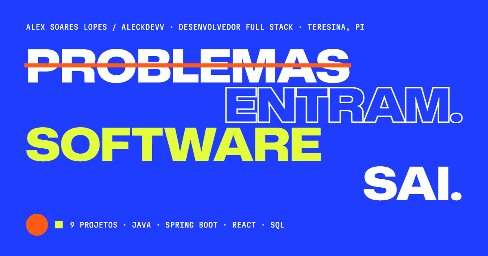

# Portfólio — Alex Soares Lopes (AleckDevv)

Portfólio pessoal de desenvolvedor full stack com 10 projetos reais: 9 com repositório público no GitHub e o Sistema Pilates, de repositório privado. Identidade visual própria (azul elétrico, papel, amarelo ácido, laranja e ciano), tipografia variável que reage ao cursor, composições diferentes para cada projeto, páginas de estudo de caso, modo técnico opcional e nenhuma barra de progresso.



## Stack e decisões

| Item | Escolha | Por quê |
|---|---|---|
| Interface | React 19 + TypeScript 6 | Componentes tipados; o conteúdo dos projetos é verificado em tempo de compilação. |
| Estilo | Tailwind CSS 4 (configuração em CSS) | Tokens de cor/tipografia num só lugar (`src/styles/global.css`). |
| Rotas | React Router 8 (modo declarativo) | Página inicial, `/projetos/:slug` e 404. |
| Build | Vite 8 + pré-renderização própria | Cada rota vira um HTML estático com conteúdo e metadados (SEO/Open Graph) já no `<head>`. Funciona em qualquer hospedagem estática. |
| Animações | CSS + hooks próprios | O Motion foi testado e removido: as animações usadas (cortina, linha do diagrama, paralaxe, prévia que segue o cursor) cabem em CSS e ~3 KB de código, economizando ~45 KB gzip. GSAP não foi necessário. |
| Fontes | Mona Sans e Martian Mono (variáveis, auto-hospedadas) | Eixos de peso e largura usados na tipografia cinética; nenhum pedido a servidores externos. |
| Imagens | AVIF + WebP responsivos (sharp) | Capturas reais dos projetos em várias larguras, com dimensões fixas (sem saltos de layout). |

Sem backend e sem banco de dados: não há necessidade para um portfólio estático.

## Como executar

Requisitos: **Node.js 24** (a mesma versão usada no build da Vercel).

```bash
npm install
npm run dev        # desenvolvimento em http://localhost:5173
npm run build      # tipos + build do cliente + SSR + pré-renderização → dist/
npm run preview    # serve dist/ como em produção (http://localhost:4173)
```

> O projeto está dentro do OneDrive. Se a sincronização deixar o `npm install` lento, pause o OneDrive durante a instalação ou mova a pasta para fora dele.

## Onde editar o conteúdo

| Arquivo | O que contém |
|---|---|
| `src/content/profile.ts` | Nome, título do hero (linhas e estilos), apresentação, **formação** (vazia por padrão — o bloco só aparece quando preenchida), **objetivos**, e-mail, GitHub e LinkedIn. |
| `src/content/projects.ts` | Fonte única dos 10 projetos: textos, funcionalidades confirmadas, tecnologias, links, capturas, cores de identidade, composição na home e ficha técnica. |
| `src/content/technologies.ts` | Tecnologias por categoria, com explicação e status `pratica` (usada em projetos) ou `estudo` (aprendizado em andamento). Os projetos em que cada uma aparece são calculados a partir de `projects.ts`. |
| `src/content/site.ts` | Título, descrição e URL pública do site. |

Para adicionar a URL de demonstração de um projeto (por exemplo, se o IaWorkout for publicado), preencha `links.demo` em `projects.ts`.

### Imagens

As capturas brutas ficam em `assets-src/` (fora do Git). Para regenerar:

```bash
npm run capture              # captura as demos publicadas (usa o Google Chrome instalado)
npm run capture -- vieira    # só um projeto
npm run fetch:repo-images    # baixa as capturas que já existem nos repositórios (IaWorkout, Agência)
npm run images               # gera AVIF/WebP, as plantas (<nome>.edges.webp) e o manifesto tipado
npm run og                   # gera as imagens Open Graph e os ícones
```

O otimizador publica somente as imagens referenciadas em `projects.ts`. Para usar uma nova captura, coloque o PNG em `assets-src/captures/<slug>/`, referencie o ID (`<slug>/<nome>`) em `projects.ts` e rode `npm run images`.

O Sistema Pilates não tem demo pública: as capturas em `assets-src/captures/pilates/` foram feitas com o sistema rodando localmente, em um banco de demonstração separado e com dados fictícios (detalhes em [docs/verificacao-dos-projetos.md](docs/verificacao-dos-projetos.md)). Por isso ele não entra no `npm run capture`.

Projeto de repositório privado: em `projects.ts`, use `links.privateRepo` (texto do aviso) no lugar de `links.repo`; o site mostra "Repositório privado" em vez do link e omite `codeRepository` no JSON-LD.

## Testes e validação

```bash
npm run lint          # Oxlint
npm run typecheck     # TypeScript
npm test              # Vitest: dados, contraste, ausência de barras de progresso, SEO e configuração da Vercel
npm run build
npm run test:e2e      # Playwright (Chrome instalado) sobre o build, com os cabeçalhos do vercel.json: navegação, teclado, diálogos, responsividade e axe-core
npm run validate      # tudo acima em sequência
npm run check:links   # confere repositórios, demonstrações e contatos (HTTP)
npm run audit:demos   # mede rolagem horizontal e erros de JS nas demos publicadas
```

Resultado da última execução (15/10/2026): lint sem avisos, 21 testes unitários e 96 testes de ponta a ponta aprovados (desktop 1440 px e celular 390 px), auditoria axe sem violações graves (WCAG 2.2 AA), nenhuma rolagem horizontal de 320 a 1920 px e 19 links externos respondendo.

Para revisar visualmente: com `npm run preview` rodando, `node scripts/review-screens.mjs` salva capturas do próprio portfólio em várias larguras.

## Publicação

O build gera um site 100% estático em `dist/` (cada rota tem seu `index.html`, além de `404.html`, `sitemap.xml` e `robots.txt`).

### Vercel (configuração pronta)

O arquivo `vercel.json` já define tudo: `npm ci`, `npm run build` (com a pré-renderização), pasta `dist`, Node 24, barra final nas URLs, cabeçalhos de segurança (CSP com hash do script inline, `nosniff`, bloqueio de iframe) e cache longo para os arquivos com hash.

**Endereço do site:** `https://portifolioalexsoares.vercel.app`, definido em `PRODUCTION_URL` (`src/content/site.ts`) e usado no canonical, no sitemap e nas imagens de compartilhamento. Para que esse endereço funcione, ele precisa estar cadastrado no projeto da Vercel:

1. No projeto, abra *Settings → Domains* e adicione `portifolioalexsoares.vercel.app`.
2. (Opcional) No domínio antigo gerado pela Vercel, escolha *Edit → Redirect to* `portifolioalexsoares.vercel.app`.
3. (Opcional) Em *Settings → General*, renomeie o projeto para `portifolioalexsoares`.

Para trocar de domínio no futuro, cadastre o novo domínio na Vercel e altere `PRODUCTION_URL`.

**Pelo GitHub (recomendado: cada `git push` publica uma nova versão)**

1. Envie a pasta para um repositório no GitHub.
2. Em [vercel.com/new](https://vercel.com/new), importe o repositório. Não altere *Framework*, *Build Command* nem *Output Directory*: eles vêm do `vercel.json`.
3. Clique em **Deploy**.

**Pela linha de comando**

```bash
npx vercel login      # uma vez: entra na sua conta (abre o navegador)
npx vercel            # cria o projeto e publica uma versão de pré-visualização
npx vercel --prod     # publica na URL de produção
```

Ao criar o projeto pela CLI, responda `portifolioalexsoares` quando ela perguntar o nome do projeto.

Para testar localmente exatamente como na Vercel (mesmos cabeçalhos e redirecionamentos do `vercel.json`): `npm run build && npm run preview`.

> Se você alterar o script inline de `index.html`, atualize o hash correspondente na CSP do `vercel.json` — o teste `tests/unit/deploy.test.ts` falha e mostra o valor correto.

### Netlify ou outro host estático

Comando de build `npm run build`, pasta `dist` e a variável `VITE_SITE_URL` com o endereço final (ex.: `VITE_SITE_URL=https://seu-dominio npm run build`).

### GitHub Pages

Alternativa opcional ao deploy na Vercel. O workflow `.github/workflows/deploy-pages.yml` roda só manualmente (aba *Actions → Publicar no GitHub Pages → Run workflow*), depois de ativar *Settings → Pages → Source: GitHub Actions*.

- **Repositório `portifolio`** (site de projeto, `https://aleckdevv.github.io/portifolio/`): `BASE_PATH: "/portifolio/"` (já configurado).
- **Repositório `AleckDevv.github.io`** (site de usuário, `https://aleckdevv.github.io`): use `BASE_PATH: "/"`.

## Estrutura

```
src/
  content/       dados (perfil, projetos, tecnologias, manifesto de imagens)
  components/    hero, projetos (10 composições), seções, mídia, layout, ui
  pages/         HomePage, ProjectPage, NotFoundPage
  lib/           preferências, transições, SEO, rolagem, hooks
  styles/        tokens e base (Tailwind 4)
  entry-client.tsx / entry-server.tsx
scripts/         captura, otimização, OG, pré-renderização, servidor e verificações
tests/           unit (Vitest) e e2e (Playwright)
docs/            relatório de verificação dos projetos
```

## Animação das telas — "do código à tela"

Cada captura de projeto chega primeiro como **planta**: os contornos da própria interface, gerados no build (`scripts/optimize-images.mjs`, detecção de bordas com sharp) e pintados em ciano sobre uma grade azul-noite. Quando a tela entra na área visível, as linhas são desenhadas e uma **linha de renderização** amarela desce pintando a tela real (`src/components/media/RenderShot.tsx`). Nas abas do Vieira, cada troca de módulo renderiza a nova tela.

- **Raio-x:** com mouse, uma lente circular mostra a planta por baixo da tela, e a moldura inclina na direção do cursor com um brilho.
- **Subida em 3D:** as molduras sobem e endireitam enquanto entram na tela, guiadas pela rolagem (CSS `animation-timeline: view()`; sem suporte, ficam estáticas).
- **Leveza:** a planta (~30 KB) só é baixada quando a tela se aproxima. O HTML pré-renderizado mostra as imagens prontas, e o efeito só é armado para telas que ainda não apareceram.
- **Sem efeito:** com movimento reduzido, em aparelhos limitados e no toque (raio-x e inclinação), as telas aparecem prontas.

## Abertura — "o portfólio se compila na sua frente"

A cada entrada ou recarregamento da página inicial, uma abertura de ~3 s (`src/components/intro/Intro.tsx`):

1. **Registro:** painel azul-noite com marcas de registro nos cantos (nome, papel, cidade, número de projetos) e a grade técnica.
2. **Maço de projetos:** as capas dos 10 projetos são distribuídas como cartas, cada uma com a planta da própria interface. Um letreiro passa o nome de cada projeto (sem porcentagens nem barras). Ao fundo, "Problemas entram." em contorno gigante.
3. **Renderização:** a linha ácida renderiza a carta do topo (o projeto mais recente) e o fundo vira "Software sai.".
4. **Entrega:** o painel sobe com a borda curva e o título do hero sobe linha a linha — a abertura termina dentro do site, não antes dele.

Referências: o preloader que se transforma no topo da página (Hildén & Kaira, Awwwards), a pilha de imagens de introdução (Codrops, *Image Stack Intro Animation*), os preloaders tipográficos (Monolith/CUSP, Awwwards) e as cortinas curvas de entrada.

- **Antes do JavaScript:** a decisão é do script inline de `index.html` (atributo `data-intro` no `<html>`, com hash na CSP de `vercel.json`) e toda a sequência é CSS. Sem JavaScript, nada bloqueia a página.
- **Pular:** clique, qualquer tecla, rolagem ou toque adiantam a sequência direto para a cortina.
- **Recomeça do zero:** entrar ou recarregar a página inicial volta ao topo, descarta a âncora da última seção visitada (`#projetos`, `#contato`…) e não restaura a rolagem anterior — tudo decidido antes da primeira pintura.
- **Quando não toca:** com movimento reduzido, em quem chega direto a um estudo de caso e ao voltar/avançar no histórico (aí o navegador mantém a posição).
- **Peso:** as cartas usam plantas pequenas (~12 KB cada, `<nome>.edges-sm.webp`, geradas só para as capas).

## Acessibilidade e desempenho

- HTML semântico, link para pular ao conteúdo, foco visível em todas as cores de fundo, navegação completa por teclado (abas com setas, diálogos nativos com Esc), anúncio de troca de página e foco movido para o conteúdo.
- Contraste mínimo de 4,5:1 conferido por teste para todas as cores de identidade dos projetos.
- `prefers-reduced-motion` respeitado; o rodapé permite escolher animações *Sistema*, *Reduzidas* ou *Completas*. Em aparelhos com pouca memória ou economia de dados, a rede animada e os efeitos de cursor ficam desligados.
- Conteúdo pré-renderizado (visível sem JavaScript), fonte principal pré-carregada, imagens sob demanda e um único bundle de ~120 KB gzip.

## Verificação dos projetos

Todas as descrições foram conferidas nos repositórios e nas demonstrações. O detalhamento, com o que foi encontrado em cada projeto e os pontos que pedem sua atenção, está em [`docs/verificacao-dos-projetos.md`](docs/verificacao-dos-projetos.md).
